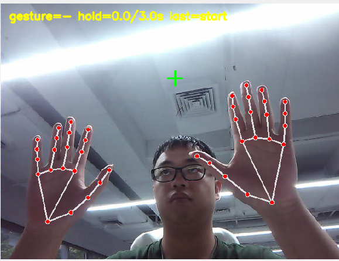
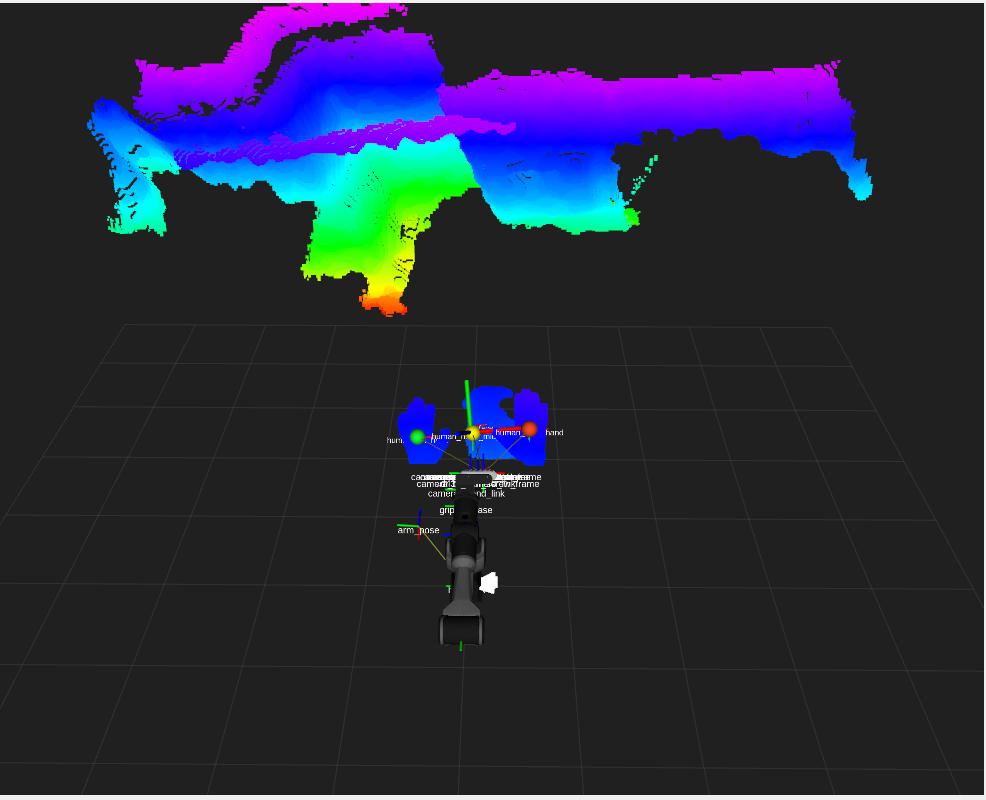
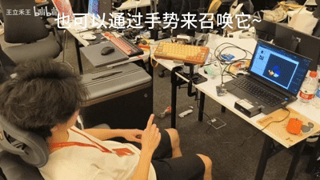

# PiPER项目案列--智能键盘

将PiPER和键盘结合，使用深度相机检测用户手部位置，自动调整键盘，使键盘保持在用户面前合适的位置。该项目是在杭州AdventureX中开发的demo，使用的时候注意安全

其数据流程为：

```
Orbbec彩色图、深度图
                ↓
MediaPipe人体与双手关键点检测
                ↓
深度采样与双手三维位置计算
                ↓
TF转换到机械臂base_link坐标系
                ↓
人体工学目标与安全距离状态机
                ↓
笛卡尔视觉伺服
                ↓
阻尼最小二乘逆解
                ↓
生成J1～J5关节指令
                ↓
Piper-X机械臂运动
```

## 使用环境

- ubuntu 22.04
- ROS2 humble
- CUDA 12.8
- python 3.10 (使用conda虚拟环境)

## 环境配置

### 下载代码

```bash
mkdir -p agilex_ws/src
cd ~/agilex_ws/src
git clone https://github.com/smalleha/Adx_PiPER_Intelligent_workstation.git
```

### 下载机械臂模型

```bash
cd ~/agilex_ws/src
git clone https://github.com/agilexrobotics/agx_arm_sim.git
# 初始化子模块，拉取完整的模型资源
cd agx_arm_sim
git submodule update --init --recursive
```

### 安装相机驱动

具体安装方法可以参考，OrbbecSDK_ROS2中的README

```bash
cd agielx_ws/src 
git clone https://github.com/orbbec/OrbbecSDK_ROS2.git -b main
```

### 创建conda虚拟环境

```bash
conda create -n yolo_face python=3.10
conda activate yolo_face 
pip install numpy==1.26.1 opencv-python onnxruntime-gpu 
```

### 构建功能包

```
cd ~/agilex_ws
colcon build 
```

## 功能使用

启动相机

```
ros2 launch orbbec_camera dabai.launch.py depth_registration:=true
```

启动手部识别功能

```
conda activate yolo_face

ros2 launch piper_x_face_follow body_hand_tracking.launch.py \
  actual_motion:=false tf_calibrated:=false \
  publish_robot_tf:=true publish_camera_mount_tf:=true \
  mount_x:=0.0 mount_y:=0.0 mount_z:=0.0 \
  mount_roll:=0.0 mount_pitch:=-1.5708 mount_yaw:=0.0
```





启动PiPER控制

据相机坐标系内双手中点的左右误差控制 J1，不做绝对空间规划。 跟踪仍默认关闭，并且首次只允许 J1 `±1°`；必须满足双手均有有效深度、 人体/双手稳定、双手没有放在键盘上、机械臂无错误、J6 未漂移，再显式调用 `/piper_x_face_follow/enable_tracking` 才会发布命令。

```bash
ros2 launch piper start_single_piper.launch.py

ros2 launch piper_x_face_follow body_hand_tracking.launch.py \
  actual_motion:=true tf_calibrated:=false \
  publish_robot_tf:=true publish_camera_mount_tf:=false \
  show_image:=false show_rviz:=true \
  j1_max_offset_deg:=1.0 j23_max_offset_deg:=0.0 \
  max_speed_deg_s:=0.5 driver_speed_percent:=2
```

如果左右方向相反，停止并失能后重新 launch，增加：

```
j1_gain_rad_per_m:=0.70
```



## 致谢

感谢AdventureX 松灵赛道--智能人体工学工作站--摆烂大队，提供的绝佳创意，开源的项目案例

开源链接：

[PIPER-X Smart Workstation](https://github.com/lansijian/piper-x-smart-workstation/tree/main)

demo 视频：

https://www.bilibili.com/video/BV1eZ336pEAr?t=1.4