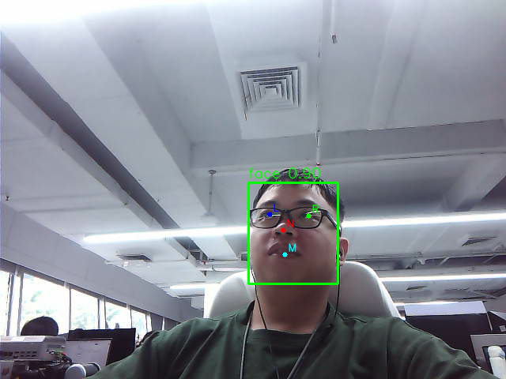
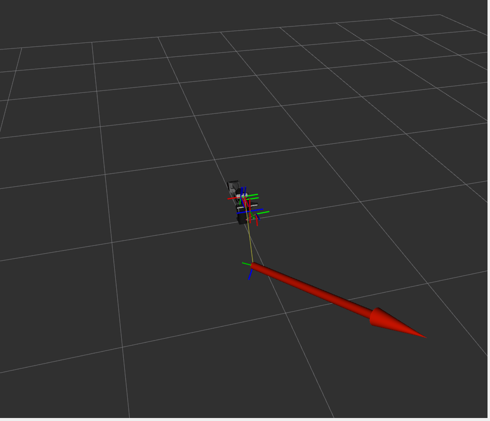

# PiPER项目案列--智能显示器

将PiPER和显示器结合，使用深度相机检测用户面部位置，自动调整显示器，使显示屏保持在用户面前合适的位置。该项目是在杭州AdventureX中开发的demo，使用的时候注意安全

其数据流程为：

```
Orbbec彩色图、深度图
        ↓
YOLOv5-Face检测人脸及五个关键点
        ↓
深度反投影得到人脸三维位置
        ↓
发布face坐标系
        ↓
根据人脸位置和预设偏移计算arm_pose
        ↓
平滑生成机械臂末端位姿指令
        ↓
发布/pos_cmd
        ↓
PiPER机械臂移动显示屏
```


## 使用环境

- ubuntu 22.04
- ROS2 humble
- CUDA 12.8
- python 3.10 (使用conda虚拟环境)

## 环境配置

### 下载代码

```bash
mkdir -p agilex_ws/src
cd ~/agilex_ws/src
git clone https://github.com/smalleha/Adx_PiPER_Intelligent_workstation.git
```

### 下载机械臂模型

```bash
cd ~/agilex_ws/src
git clone https://github.com/agilexrobotics/agx_arm_sim.git
# 初始化子模块，拉取完整的模型资源
cd agx_arm_sim
git submodule update --init --recursive
```

### 安装相机驱动

具体安装方法可以参考，OrbbecSDK_ROS2中的README

```bash
cd agielx_ws/src 
git clone https://github.com/orbbec/OrbbecSDK_ROS2.git -b main
```

### 创建conda虚拟环境

```bash
conda create -n yolo_face python=3.10
conda activate yolo_face 
pip install numpy==1.26.1 opencv-python onnxruntime-gpu
```

### 下载模型

推荐保持默认目录结构：

```bash
mkdir -p /home/$USER/yolov5-face/weights
curl -L -o /home/$USER/yolov5-face/weights/yolov5n_face.onnx \
  https://github.com/yakhyo/yolov5-face-onnx-inference/releases/download/weights/yolov5n_face.onnx
```

s还需要修改：

```text
orbbec_face_landmark/config/orbbec_face_landmark.yaml
```

把：

```yaml
model_path: /home/grubaxu/yolov5-face/weights/yolov5n_face.onnx
```

改成：

```yaml
model_path: /home/$USER/yolov5-face/weights/yolov5n_face.onnx
```

### 构建功能包

```
cd ~/agilex_ws
colcon build 
```

## 功能使用

启动相机

```
ros2 launch orbbec_camera dabai.launch.py depth_registration:=true
```

启动人脸识别功能，注意yolov5n_face.onnx的路径是否正确

```
conda activate yolo_face
ros2 launch orbbec_face_landmark orbbec_face_landmark.launch.py
```



启动TF目标预览，生成目标 TF，不会直接向机械臂发送

```
ros2 launch agx_arm_description display.launch.py arm_type:=piper end_effector:=gripper with_camera_stand:=true with_camera:=true

ros2 launch face_tf_2_piper_link6 face_tf_2_piper_link6.launch.py
```



启动PiPER控制

只有完成下面检查后才可启动：

1. CAN、机械臂反馈和急停正常；
2. `base_link → face` 与 `base_link → arm_pose` 方向正确；
3. 当前只有一个 `arm_pose` 发布器；
4. 当前只有一个 `/pos_cmd` 发布器；
5. 目标位于当前显示屏机械臂可达且无碰撞的区域。

```
ros2 launch piper start_single_piper.launch.py

ros2 launch piper_tf_control piper_tf_control.launch.py
```


## 致谢

感谢AdventureX 松灵赛道--智能人体工学工作站--摆烂大队，提供的绝佳创意，开源的项目案例

开源链接：

[PIPER-X Smart Workstation](https://github.com/lansijian/piper-x-smart-workstation/tree/main)

demo 视频：

https://www.bilibili.com/video/BV1eZ336pEAr?t=1.4